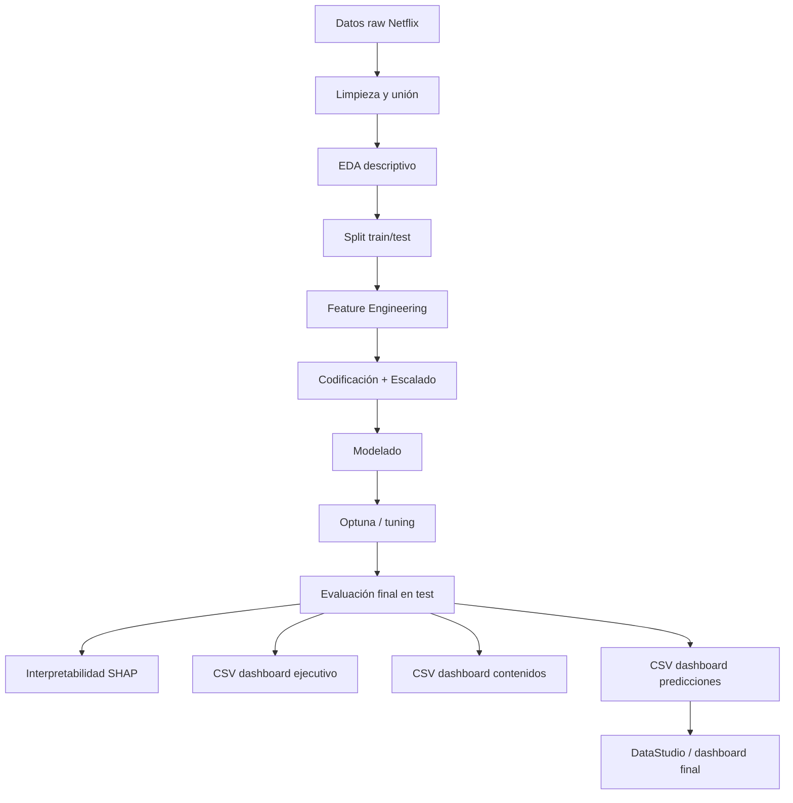

# Checklist maestro del proyecto StreamView Analytics (ETAPA PREDICTIVA)

## 0. Decisiones tomadas en la fase 0

### Decisión 1: objetivo dual del proyecto
Se mantiene la capa descriptiva y analítica del catálogo, pero se incorpora una capa predictiva orientada a estimar el potencial de éxito futuro de los títulos para apoyar decisiones de adquisición, renovación y producción.

### Decisión 2: variable objetivo continua + clasificación por niveles
Se define `indice_exito` como variable objetivo continua y, además, una categoría derivada con tres niveles:
- Bajo Éxito
- Medio Éxito
- Alto Éxito

### Decisión 3: uso de `vote_count`, `vote_average` y `popularity` en la construcción del score
Se integran las tres señales para evitar decisiones sesgadas por visibilidad o por respaldo aislado. El `score` debe reflejar visibilidad, respaldo y calidad percibida.

### Decisión 4: uso de `budget` y `revenue` para películas
Se incorporan `budget` y `revenue` como variables relevantes para la evaluación de películas porque el negocio puede generar futuras producciones propias. La comparación entre inversión y retorno ayuda a detectar qué tipos de películas tienen mejor costo-beneficio.

### Decisión 5: priorización del metric setup del modelo
Se prioriza la métrica de negocio y la clasificación de alto potencial sobre métricas puramente técnicas. En la práctica se usará:
- para regresión continua: RMSE/MAE,
- para clasificación binaria y segmentación por nivel: ROC-AUC, F1, Precision/Recall y Precision@K,
- además, se revisará ranking por `indice_exito` para priorizar títulos recomendados.

### Decisión 6: continuidad del flujo tradicional + validación complementaria con PyCaret
Se mantiene el proceso tradicional de sklearn y se usa PyCaret como validación adicional de benchmarking, no como reemplazo del flujo principal.

### Decisión 7: mockup en HTML usando Bootstrap
Se crea una maqueta de baja fidelidad en HTML con Bootstrap para reflejar el diseño del dashboard actual y facilitar la coordinación con el compañero que implementará DataStudio.

---

## 1. Alcance y objetivo del proyecto

### Objetivo general
El proyecto mantiene la capa descriptiva y analítica del catálogo, pero incorpora una capa predictiva orientada a estimar el potencial de éxito futuro de los títulos para apoyar decisiones de adquisición, renovación y producción.

### Objetivo de negocio
Identificar qué factores del contenido (género, país, idioma, tipo, año, valoración, respaldo de votos, presupuesto e ingresos) están asociados con un mayor nivel de éxito, y usar esa evidencia para recomendar qué contenidos conviene priorizar.

### Resultado esperado
- Dashboard descriptivo: muestra qué tenemos y cómo se compone el catálogo.
- Dashboard predictivo: muestra qué títulos tienen mayores probabilidades de éxito futuro.
- Modelo con variable objetivo continua y etiquetas de clasificación por nivel de éxito.
- CSVs separados optimizados por tipo de consumo (ejecutivo, contenidos, predicciones).

---

## 2. Definición de la variable objetivo

### 2.1 Variable objetivo base: indice_exito
Se define una variable continua llamada `indice_exito`, construida a partir de cinco señales:
- `popularity`
- `vote_count`
- `vote_average`
- `budget` (solo para películas)
- `revenue` (solo para películas)

Se recomienda normalizar cada variable a escala 0-1 usando Min-Max y luego combinarla con pesos. Para la base general del score:

- 40% popularidad
- 30% respaldo de votos
- 30% valoración promedio

Cuando se esté evaluando el subconjunto de películas con datos financieros completos, se puede incorporar una segunda capa de ajuste del score:

- `roi_approx` como señal de rentabilidad relativa,
- `budget` y `revenue` como controles de inversión y retorno,
- `roi_approx` se recomienda como un ajuste condicionado a que el presupuesto sea mayor que cero.

Fórmula sugerida para la base del score:

`indice_exito = 0.40 * popularity_norm + 0.30 * vote_count_norm + 0.30 * vote_average_norm`

Fórmula sugerida para películas con información financiera:

`indice_exito_financiero = indice_exito * 0.80 + roi_norm * 0.20`

> La segunda fórmula solo debe aplicarse cuando exista cobertura financiera suficiente y el contexto de negocio lo amerite.

### 2.2 Justificación del uso combinado
- `popularity`: refleja visibilidad relativa del título en la fuente.
- `vote_count`: refleja cuántas evaluaciones respaldan la percepción general.
- `vote_average`: refleja la calidad percibida por la audiencia.
- `budget` y `revenue`: permiten evaluar el costo-beneficio de las producciones propias en películas y detectar cuáles tienen mejor viabilidad económica.

Esto evita errores como:
- elegir un título muy popular pero con pocas evaluaciones,
- elegir un título con muchos votos pero mala calificación,
- elegir un título con buena valoración general pero que no tiene viabilidad económica si se produciría en-house.

### 2.3 Variable objetivo categórica derivada
Para facilitar la priorización del dashboard y la toma de decisiones, se generará una clasificación en 3 niveles:

- `Bajo Éxito`: `indice_exito < 0.35`
- `Medio Éxito`: `0.35 <= indice_exito < 0.70`
- `Alto Éxito`: `indice_exito >= 0.70`

> Se debe validar esta distribución empíricamente con cuartiles, mediana y densidad. Los límites pueden ajustarse si la distribución real de `indice_exito` indica que los cortes no son representativos.

### 2.4 Regla de negocio para la calidad de la valoración
- Para analizar `vote_average` con rigor, se debe aplicar un mínimo de votos.
- Recomendación inicial: usar solo títulos con `vote_count >= 100` para construir la parte de valoración del score o, al menos, penalizar fuertemente los títulos con pocos votos.

### 2.5 Regla de negocio para la popularidad
- `popularity` es un índice relativo de la fuente y no representa reproducciones ni usuarios reales de StreamView.
- No debe interpretarse como consumo real del servicio.
- Debe leerse junto con `vote_count` y `vote_average`.

### 2.6 Regla de negocio para películas con `budget` y `revenue`
- `budget` y `revenue` solo son relevantes para películas.
- Deben ir acompañados de una advertencia clara: no representan costos ni ingresos reales de StreamView, solo datos reportados por la fuente.
- Se debe analizar `roi_approx` y la relación entre `budget` y `revenue` como referencia para decisión productiva, no como medida definitiva de rentabilidad del negocio.

---

## 3. Correlación clave a evaluar: vote_count y vote_average

### Objetivo de la revisión
Se debe estudiar correctamente la relación entre estas dos variables antes de construir el score final, porque pueden estar asociadas a la misma señal y ser engañosas si se interpretan por separado.

### Regla de evaluación
- Revisión de correlación lineal.
- Análisis de dispersión.
- Identificar si hay títulos con:
  - alta calificación y pocos votos,
  - muchos votos y baja calificación,
  - alta popularidad con baja valoración,
  - alta valoración con respaldo fuerte.

### Recomendación metodológica
- Evaluar la relación `vote_count` vs `vote_average` con scatter plot y correlación de Pearson.
- Si existe una relación no lineal o una distribución muy sesgada, considerar transformaciones logarítmicas para `vote_count` antes del escalado.
- Si el comportamiento varía por tipo (`Movie` vs `TV Show`), hacer análisis separados por tipo.
- Validar si los títulos con muchos votos y valoración alta están realmente diferenciados de los títulos con pocas evaluaciones.

### Evidencia mínima requerida en el notebook
- Scatter plot: `vote_count` vs `vote_average`
- Histograma de `vote_count`
- Histograma de `vote_average`
- Boxplot por tipo
- Correlación por grupo
- Análisis de densidad por nivel de éxito

---

## 4. Reglas para split de datos y prevención de data leakage

### Sección obligatoria del notebook
El split train/test debe hacerse antes de cualquier transformación, imputación, escalado o codificación.

### Regla recomendada
- Train: 80%
- Test: 20%
- Random state fijo para reproducibilidad

### Flujo correcto
1. Cargar datos limpios.
2. Separar `X` e `Y`.
3. Hacer `train_test_split` antes del preprocessing.
4. Ajustar transformadores solo sobre train.
5. Aplicar transformaciones sobre test.
6. Evaluar luego en el conjunto reservado.

### No permitido
- Ajustar escaladores sobre todo el dataset antes del split.
- Codificar categorías sobre el dataset completo.
- Imputar nulos sobre train y test combinados.

---

## 5. Estructura sugerida del proyecto

### 5.1 Estructura de carpetas

```text
project/
├── data/
│   ├── raw/
│   │   ├── netflix_movies_detailed_up_to_2025.csv
│   │   └── netflix_tv_shows_detailed_up_to_2025.csv
│   └── processed/
│       ├── catalogo_streamview.csv
│       ├── train_data.csv
│       ├── test_data.csv
│       ├── dashboard_ejecutivo.csv
│       ├── dashboard_contenidos.csv
│       └── dashboard_predicciones.csv
├── docs/
│   ├── project_brief.md
│   ├── checklist_proyecto_streamview_predictivo.md
│   └── dashboard_guide.md
├── images/
│   ├── dashboard_streamview.html
│   ├── mockup_dashboard_baja_fidelidad.html
│   └── mockup_dashboard_baja_fidelidad.png
├── notebooks/
│   ├── 01_EDA.ipynb
│   ├── 02_Feature_Engineering.ipynb
│   ├── 03_Modelo.ipynb
│   └── 04_Pipeline.ipynb
├── src/
│   ├── pipeline.py
│   ├── preprocessing.py
│   ├── feature_engineering.py
│   └── model_utils.py
├── models/
│   ├── best_model.pkl
│   └── preprocessing_pipeline.pkl
├── requirements.txt
├── README.md
└── .gitignore
```

### 5.2 Diagrama de flujo del proyecto



---

## 6. Guía de dashboard para DataStudio

### Objetivo del dashboard final
El dashboard debe tener dos capas:
1. Capa descriptiva: ¿qué tenemos y qué tendencia se observa?
2. Capa predictiva: ¿qué contenidos conviene priorizar?

### Estructura sugerida por sección

#### A. Header o resumen ejecutivo
Elementos:
- título del dashboard
- subtítulo del proyecto
- selector de tipo: Películas / Series / Todos
- selector de género
- selector de país
- selector de idioma
- filtro por año
- filtro por nivel de éxito: Bajo / Medio / Alto

#### B. Panel de KPIs principales
- Total de títulos
- Películas vs series
- Popularidad promedio
- Vote_average promedio
- Vote_count promedio
- % de títulos en `Alto Éxito`
- % de títulos en `Bajo Éxito`
- ROI aproximado promedio (solo películas con datos completos)

#### C. Panel de análisis descriptivo
- Distribución por tipo
- Géneros con mayor presencia
- Países con mayor asociación
- Idiomas predominantes
- Evolución por año de incorporación / estreno
- Comparativa de presupuesto e ingresos por género o tipo

#### D. Panel de análisis de éxito
- Ranking de títulos por `indice_exito`
- Ranking por género y país
- Scatter plot de `vote_count` vs `vote_average`
- Segmentación de títulos por categoría: Alto / Medio / Bajo Éxito
- Panel de `budget` y `revenue` para películas

#### E. Panel predictivo
- Títulos recomendados para adquisición
- Probabilidad estimada
- Clase predicha
- Variables más influyentes (SHAP)
- Señales de costo-beneficio para películas
- Alertas del modelo

#### F. Panel de advertencias y contexto
- `popularity` es un índice relativo
- `vote_count` y `vote_average` deben interpretarse juntos
- `budget` y `revenue` solo aplican a películas y no representan costos reales de StreamView
- El modelo no sustituye la decisión humana
- No se dispone de datos internos reales de StreamView

---

## 7. Mockup de baja fidelidad del dashboard

### 7.1 Consideración de diseño
El mockup debe seguir la lógica visual ya presente en el proyecto actual y en la estructura del PDF de referencia: enfoque ejecutivo, paneles de KPIs, separación por tipo, filtros globales y jerarquía visual con alto impacto analítico. En ausencia del PDF original como archivo accesible en el workspace, se toma la estructura general del proyecto y del dashboard actual como referencia visual.

### 7.2 Layout sugerido (HTML + Bootstrap)
Se crea una maqueta en HTML con Bootstrap para facilitar la construcción posterior en DataStudio y mantener una visualización clara y adaptativa.

Archivo sugerido:
- `images/mockup_dashboard_baja_fidelidad.html`

### 7.3 Distribución sugerida del layout

```text
+--------------------------------------------------------------------------------------+
| HEADER / FILTROS                                                                     |
| [Tipo] [Género] [País] [Idioma] [Año] [Nivel del éxito] [Reset]                    |
+--------------------------------------------------------------------------------------+
| KPI 1    | KPI 2    | KPI 3    | KPI 4    | KPI 5    | KPI 6                         |
+--------------------------------------------------------------------------------------+
| GRÁFICO DESC. 1: distribución por tipo     | GRÁFICO DESC. 2: top géneros           |
| barras o donut                              | barras horizontales                  |
+--------------------------------------------------------------------------------------+
| GRÁFICO DESC. 3: top países                | GRÁFICO DESC. 4: evolución temporal |
| mapa / barras                              | línea o área                        |
+--------------------------------------------------------------------------------------+
| GRÁFICO PRED. 1: ranking de títulos       | GRÁFICO PRED. 2: scatter vote_count vs vote_average |
| tabla con score y clase                    | dispersión con color por categoría |
+--------------------------------------------------------------------------------------+
| GRÁFICO PRED. 3: recomendados por género   | GRÁFICO PRED. 4: SHAP / variables influyentes |
| tabla / barras compactas                   | barras con importancia            |
+--------------------------------------------------------------------------------------+
| GRÁFICO FINANCIERO: budget vs revenue      | TABLA: ranking de títulos recomendados     |
| scatter completo en películas               | score + clase + ROI + prioridad           |
+--------------------------------------------------------------------------------------+
| DISCLAIMER / CONTEXTO / REGLAS DE NEGOCIO                                            |
+--------------------------------------------------------------------------------------+
```

### 7.4 Maqueta conceptual por componente

```text
[ TÍTULO DEL DASHBOARD ]
[ FILTROS: tipo | género | país | idioma | año | nivel de éxito ]

[ KPI: total títulos ] [ KPI: popularidad promedio ]
[ KPI: vote_average ] [ KPI: títulos recomendados ] [ KPI: % alto éxito ] [ KPI: ROI promedio ]

[ Distribución por tipo ]      [ Top géneros ]
[ Línea de evolución ]         [ Top países ]

[ Ranking de títulos por indice_exito ]         [ Scatter vote_count vs vote_average ]
[ Recomendados para adquisición ]               [ SHAP / variables influyentes ]
[ Budget vs revenue (películas) ]               [ Tabla de títulos recomendados ]

[ Nota de contexto: popularity es un índice relativo ]
[ Nota: vote_count y vote_average deben leerse juntas ]
[ Nota: budget y revenue son referencia, no rentabilidad real de StreamView ]
[ Nota: modelo no reemplaza decisiones humanas ]
```

### 7.5 Recomendación de visualizaciones para DataStudio
- Barras para géneros, países e idiomas
- Línea para evolución temporal
- Scatter plot para `vote_count` vs `vote_average`
- Scatter plot para `budget` vs `revenue` en películas
- Tabla inteligente para ranking de títulos por `indice_exito`
- Indicadores numéricos para KPIs
- Colores por categoría (`Bajo`, `Medio`, `Alto Éxito`)

---

## 8. Codificación de variables categóricas y escalado de variables numéricas

### 8.1 Variables categóricas
Se deben evaluar con criterio según el número de categorías y el tipo de variable.

#### Recomendaciones:
- `type`: One-Hot Encoding o Label Encoding simple si se usa como variable binaria nominal.
- `genres`: One-Hot Encoding si la cardinalidad es moderada; si es alta y se quiere reducir, considerar transformación por grupos o frecuencia.
- `country`: One-Hot para países frecuentes, pero revisar cardinalidad; si es muy alta puede ser preferible resúmenes por región o encoding basado en frecuencia.
- `language`: One-Hot si la variedad es manejable; si es alta, considerar agrupación por idioma principal o top N.
- `date_added` y `release_year`: convertir en features derivadas (año, trimestre, antigüedad) y no dejarlo como texto crudo.
- `budget` y `revenue`: si se usan para modelo, transformar con log1p o normalización por subgrupo cuando la distribución es muy sesgada.

### 8.2 Variables numéricas
Se deben revisar con histogramas, boxplots y skewness.

#### Recomendaciones por tipo:
- Si hay sesgo fuerte: transformar log1p o Box-Cox / Yeo-Johnson antes del modelado.
- Si la escala varía mucho: usar StandardScaler o MinMaxScaler.
- Para modelos basados en árboles, el escalado no es obligatorio, pero sí es útil para modelos lineales o SVM.
- `vote_count` y `budget` suelen requerir transformación logarítmica por su distribución sesgada.

### 8.3 Evidencia gráfica requerida para justificar la decisión
En el EDA y feature engineering debe incluirse:
- Histogramas de `popularity`, `vote_count`, `vote_average`, `budget`, `revenue`, `release_year`
- Boxplots para comparar distribución por tipo o por categoría objetivo
- Distribución de cada variable por nivel de éxito
- Heatmap de correlación
- Scatter plot `vote_count` vs `vote_average`
- Scatter plot `budget` vs `revenue` (solo películas)

### 8.4 Justificación práctica
- `vote_count` suele estar muy sesgado y asumir una distribución asimétrica; por esto, puede necesitar transformación logarítmica.
- `popularity` puede tener muchos valores extremos; requiere revisión de outliers.
- `vote_average` tiene rango acotado (0 a 10) y suele ser más estable, pero debe evaluarse considerando el número de votantes.
- `budget` y `revenue` solo aplican a películas y pueden tener muchos nulos; conviene tratarlos con rigor y solo cuando el subconjunto de datos lo permita.
- La decisión de coding/scaling debe sostenerse con evidencia gráfica y con métricas de validación, no con intuición.

---

## 9. Evaluación de modelos y decisiones de entrenamiento

### Modelos sugeridos
Se recomienda comparar al menos estos tres modelos:
1. Regresión Lineal (si la variable objetivo es continua)
2. Random Forest Regressor
3. XGBoost Regressor

### Para clasificación binaria
Además, se debe evaluar la clasificación derivada:
- `Bajo` vs `Alto` éxito
- Se pueden usar métricas como:
  - Accuracy
  - Precision
  - Recall
  - F1-score
  - ROC-AUC
  - Precision-Recall
  - Precision@K para priorizar top resultados

### Recomendación práctica
- Entrenar primero el modelo continuo (`indice_exito`)
- Usar la clasificación como capa de decisión para el dashboard
- La decisión final del dashboard se sustenta en el score continuo y la categoría binaria derivada
- Para este caso específico, la métrica más prioritaria debe ser la de ranking y clasificación de títulos de alto potencial, no solo el error absoluto. En contexto de negocio, conviene priorizar:
  - ROC-AUC o PR-AUC para clasificación,
  - Precision@K para evaluar qué proporción de los títulos recomendados realmente pertenecen a la clase de alto potencial,
  - RMSE/MAE para tener control del error en la predicción continua.

### Revisión adicional con PyCaret
- PyCaret puede usarse como validación complementaria, para comparar automáticamente varios modelos y comparar rendimiento de referencia.
- Sin embargo, no reemplaza el flujo tradicional basado en sklearn, train/test, feature engineering y validación manual.
- La práctica recomendada es: flujo tradicional + benchmark con PyCaret.

---

## 10. Checklist de tareas del proyecto

### Fase 0: definición del proyecto
- [x] Definir objetivo dual: descriptivo + predictivo
- [x] Definir variable objetivo continua `indice_exito`
- [x] Definir categorías `Bajo Éxito`, `Medio Éxito`, `Alto Éxito`
- [x] Definir estructura general del proyecto
- [x] Definir uso de train/test para evitar leakage
- [x] Definir estrategia de dashboard para DataStudio
- [x] Definir necesidad de guías y mockup visual
- [x] Definir relevancia de `budget` y `revenue` para películas
- [x] Definir estrategia de métricas prioritarias para negocio
- [x] Definir uso de PyCaret como validación complementaria
- [x] Definir mockup HTML/Bootstrap para la maquetación base
- [x] Revalidar umbrales de `indice_exito` con enfoque en distribución real
- [x] Confirmar pesos base del score: popularity, vote_count y vote_average

### Fase 1: limpieza y EDA
- [ ] Cargar los datasets raw de Netflix
- [ ] Revisar tipos, nulos y duplicados
- [ ] Unificar estructura de columnas
- [ ] Crear dataset base analítico
- [ ] Inspeccionar `df.info()`
- [ ] Revisar distribución de variables numéricas
- [ ] Revisar distribuciones categóricas
- [ ] Evaluar `vote_count` vs `vote_average`
- [ ] Generar heatmap de correlación
- [ ] Definir variables para modelado y dashboard

### Fase 2: feature engineering
- [ ] Crear `indice_exito`
- [ ] Generar categorías de éxito
- [ ] Definir codificación para variables categóricas
- [ ] Definir escalado para variables numéricas
- [ ] Investigar sesgo y outliers
- [ ] Aplicar transformaciones de forma segura en train
- [ ] Guardar datasets train y test separados

### Fase 3: modelado
- [ ] Hacer separation train/test
- [ ] Aplicar preprocessing fit-only sobre train
- [ ] Probar modelos de regresión
- [ ] Probar Random Forest
- [ ] Probar XGBoost
- [ ] Hacer tuning con Optuna
- [ ] Evaluar métricas finales en test
- [ ] Generar explicabilidad SHAP
- [ ] Seleccionar mejor modelo

### Fase 4: pipeline y dashboard
- [ ] Construir pipeline reproducible
- [ ] Guardar modelo final
- [ ] Generar csv de dashboard ejecutivo
- [ ] Generar csv de dashboard contenidos
- [ ] Generar csv de dashboard predicciones
- [ ] Revisar estructura final del dashboard con compañero
- [ ] Documentar métricas y advertencias de negocio

---

## 11. Recomendación final para la entrega

La solución final debe verse como un sistema de decisión compuesto por:
- análisis de catálogo,
- estimación de éxito futuro,
- recomendación de adquisición,
- dashboard ejecutivo con filtros y contexto,
- evaluación de viabilidad de producción para películas usando `budget` y `revenue`,
- modelo entrenado sobre un dataset limpio y validado con test reservado.

La prioridad es mantener rigor en la validación del modelo y claridad del dashboard, sin mezclar la parte descriptiva con la predictiva en un solo archivo o sin separar adecuadamente los CSVs por uso.

---

## 12. Cierre

Este documento debe servir como guía de avance para el proyecto y como base para la implementación de notebooks, pipeline y dashboard final. Cada vez que se complete una tarea, debe marcarse como finalizada en esta checklist para mantener trazabilidad del progreso.
